<div align="center">



<a href="https://github.com/FelipeAUGraciano">
  
</a>

<br/>

<a href="https://www.linkedin.com/in/felipeagraciano"></a>
<a href="mailto:felipeagraciano98@gmail.com"></a>


</div>

---

## 📜 Janela de Status

<div align="center">
  
</div>

> *"Toda grande teia começa com um único fio."* — Byte, a Cavaleira de Seda 🕷️

---

## 🧬 Linha Evolutiva da Byte

<div align="center">
  
  <br/>
  <sub>Cada repositório vale 1 nível. A Byte evolui a cada marco: Lv. 10, 25 e 50.</sub>
</div>

---

## 🗺️ Diário do Aventureiro

```diff
+ [Base]       São José dos Campos - SP
+ [Formação]   Tecnólogo em Desenvolvimento de Software Multiplataforma (Fatec)
+ [Guilda]     Simova
+ [Side quest] Criando a Cavaleira de Seda, um jogo de aranha em Godot
! [Aviso]      Este personagem converte pão de queijo em código
```

---

## ⚔️ Árvore de Habilidades

<div align="center">

**🟢 Desbloqueadas**


**🔒 Em treinamento**


</div>

---

## 🏰 Masmorras Exploradas

| Masmorra | Magia | Registro |
|---|:---:|---|
| [**API-1-DSM**](https://github.com/FelipeAUGraciano/API-1-DSM) | 🐍 Python | Primeiro projeto na Fatec, onde a jornada começou |
| [**OctAgro-API**](https://github.com/FelipeAUGraciano/OctAgro-API) | 🟨 JavaScript | Projeto API do 2º semestre de DSM |
| [**Beelieve**](https://github.com/FelipeAUGraciano/Beelieve) | 🐝 — | Projeto API do 3º semestre com a Equipe Nimbus |

---

## 🎯 Quadro de Missões

| Status | Missão | Recompensa |
|:---:|---|:---:|
| ✅ | Concluir o primeiro projeto na Fatec | `+100 XP` |
| ✅ | Ter PRs aceitos em projetos de equipe | `🦈 Pull Shark x2` |
| ✅ | Formar-se Tecnólogo em DSM | `🎓 Título: Tecnólogo` |
| ✅ | Entrar para uma guilda de devs | `🏢 Simova` |
| ✅ | Chegar a 10 repositórios | `🕸️ Evolução: Tecelã` |
| ⏳ | Chegar a 25 repositórios (17/25) | `🧬 Evolução: Arquiteta` |
| ⏳ | Lançar a Cavaleira de Seda | `🎮 Título: Game Dev` |
| ⏳ | Conquistar 10 estrelas (1/10) | `⭐ +500 XP` |

---

## 🏅 Conquistas

<div align="center">


</div>

---

## 📊 Registro de Batalha

<div align="center">


</div>

---

## 🕷️ A Byte caçando commits

<div align="center">

<picture>
  <source media="(prefers-color-scheme: dark)" srcset="https://raw.githubusercontent.com/FelipeAUGraciano/FelipeAUGraciano/output/byte-hunt-dark.svg"/>
  
</picture>

<sub>Cada quadradinho aceso é uma presa. Faça commits para alimentar a Byte! 🕸️</sub>

</div>

---

<div align="center">

```
╔══════════════════════════════════════════════╗
║   SALVAR PROGRESSO?   ▶ SIM        NÃO       ║
╚══════════════════════════════════════════════╝
```

<sub>Obrigado pela visita, viajante. Volte quando a Byte tiver subido de nível! 🕷️</sub>

</div>
